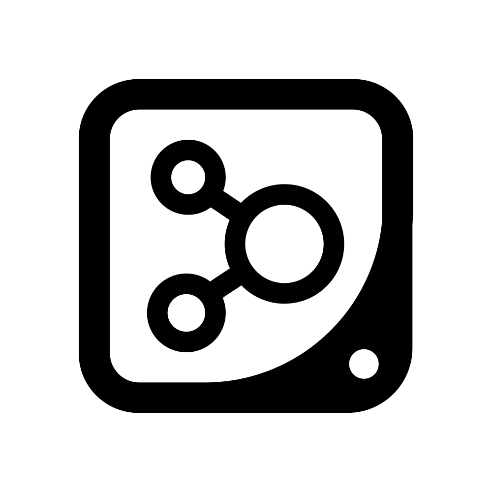
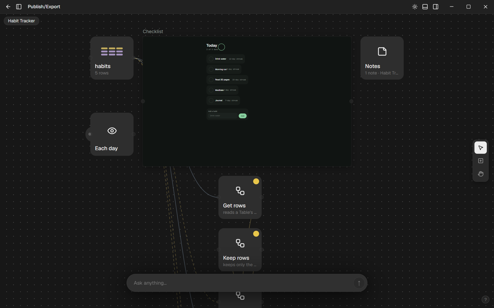
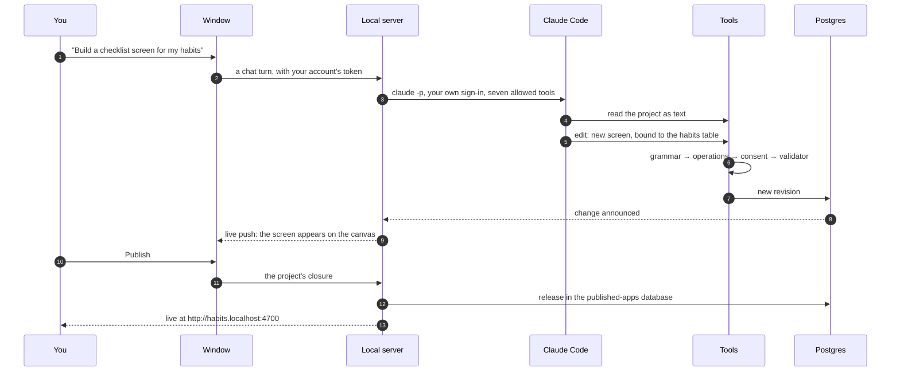
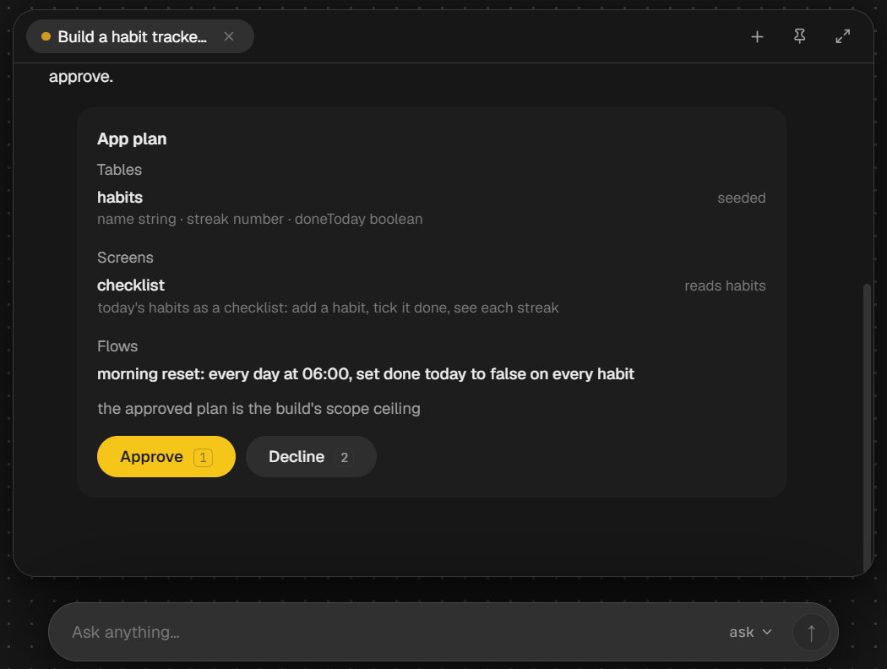
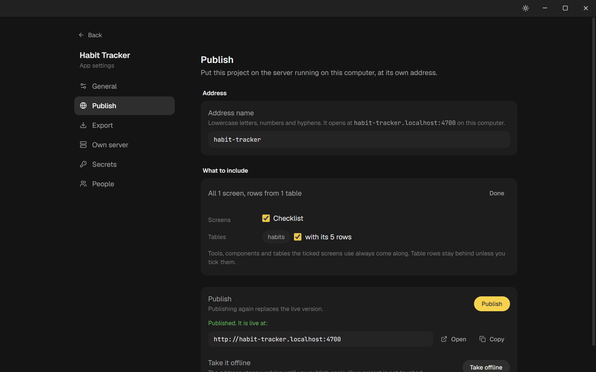
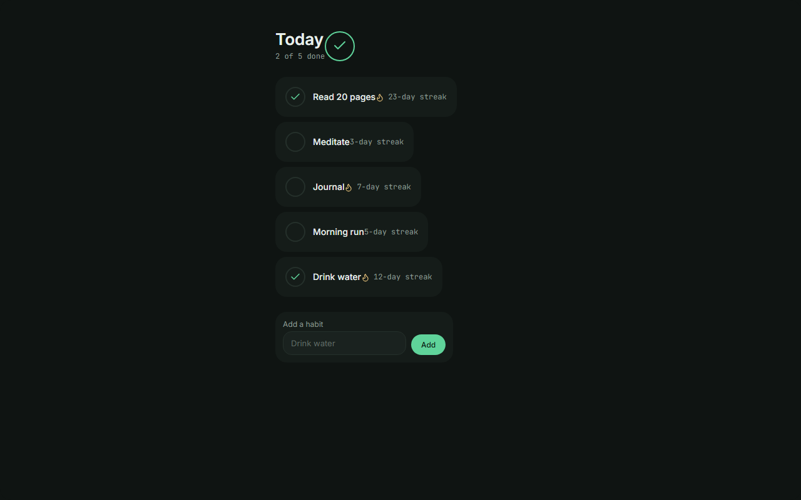

<div align="center">



# Nodeloom

**Build apps and websites on one canvas, without code, on your own computer.**

Tables, screens, flows, triggers and 80 services are nodes you place and wire together. An AI builder does the same work from a chat box, and nothing leaves your machine unless you publish it.

[](LICENSE)


[Quick start](#quick-start) · [Running](docs/running.md) · [Architecture](docs/architecture.md) · [Security](SECURITY.md) · [Contributing](CONTRIBUTING.md)

</div>

---

> [!WARNING]
> **Nodeloom is in early development (pre-1.0) and not yet stable.** We ship updates often, and releases may include breaking changes to features, the project file format and how data is stored. Pin a specific release for anything you depend on, and back up your data folder before you update.



Nodeloom is a desktop app for building real apps and websites without writing code. Everything you build lives on one canvas: a table of habits, the screen that lists them, the flow that runs every morning and the service it calls are nodes wired together. Screens are edited in place at their real size.

- **One canvas.** Tables, screens, flows (33 step types), triggers, notes and an 80-service integration shelf, placed, configured through properties and wired together.
- **Screens from five building blocks.** Frame, text, field, chart and instance, with hover, focus and pressed states and phone and tablet layouts. Charts come in ten marks, from lines and bars to donuts, heatmaps and gauges.
- **An AI builder that uses what you have.** If [Claude Code](https://docs.claude.com/en/docs/claude-code) is installed and signed in, the app finds it and uses it on your own login, with no key and no setup. An Anthropic or OpenAI API key works too.
- **Asks before it acts.** Anything that reaches outside your project or cannot be undone shows a card and waits for your Yes.
- **No AI at run time.** The AI helps you build. The apps you publish run on a plain engine with no model calls and no per-use cost.
- **Publish locally, or on your own server.** Publishing serves an app at `http://<name>.localhost:4700`. Export it as a `.tproject` file and two commands run it on any machine with Node and Postgres.
- **Local.** Your account, your projects and your data stay on your computer. Postgres is bundled, so there is nothing to set up.

## How it works

You ask, the AI edits your project through the same rules the editor uses, and every change lands as a revision you can see and undo:



It is one Electron app that starts a bundled Postgres and a small server on your own computer. Every call from the window goes through one typed router; screens are documents of five primitives checked by one validator and drawn by one engine, the same in the editor and in a published app. The [architecture guide](docs/architecture.md) covers the processes, the two databases, the router, the canvas, screens, flows, integrations, the AI builder, consent and publishing. [docs/architecture.html](docs/architecture.html) is an interactive map of the whole system (download it and open it in a browser).

| The AI building a screen | App settings | A published app |
| --- | --- | --- |
|  |  |  |

## Quick start

Requirements: Windows, Node.js 20 or newer, and optionally Claude Code for the AI builder.

```sh
git clone https://github.com/ArynBuilds/nodeloom.git && cd nodeloom
npm install
npm run desktop
```

Create your account in the window that opens. It is stored only on this computer.

The [running guide](docs/running.md) covers the installer, connecting the AI, publishing, running a project on your own server, where your data lives, backups and troubleshooting.

## Security

- One account per computer, created on first launch. Its password is hashed with scrypt and never leaves the machine.
- The server and the bundled Postgres listen on `127.0.0.1` only. API keys and service credentials are encrypted with AES-256-GCM under this install's own key.
- Claude Code runs without your personal `~/.claude` settings, with only the app's seven tools allowed. Actions that reach outside the project wait for your Yes.

Read [SECURITY.md](SECURITY.md) for the full model and its limits, and report vulnerabilities privately as described there.

## Status

Nodeloom is young open-source software, extracted from a product that ran as a hosted service.

- The desktop app is built and tested on Windows; macOS and Linux builds are not done yet.
- There is no test suite yet; changes are checked by the typecheck and by using the app.
- Services that sign in through their own page need your own app registration with that service.
- Dashboard cards do not show screen thumbnails yet.

## Development

```sh
npm run desktop          # build the screen engine and start the app
npm run typecheck        # every package
npm run build:tentkit    # the screen engine alone
npm run server -- serve  # run an installed project headless
```

[CONTRIBUTING.md](CONTRIBUTING.md) covers the setup, the conventions and the pull-request checklist. Please follow the [Code of Conduct](CODE_OF_CONDUCT.md).

## License

[MIT](LICENSE) © 2026 Nodeloom contributors.
